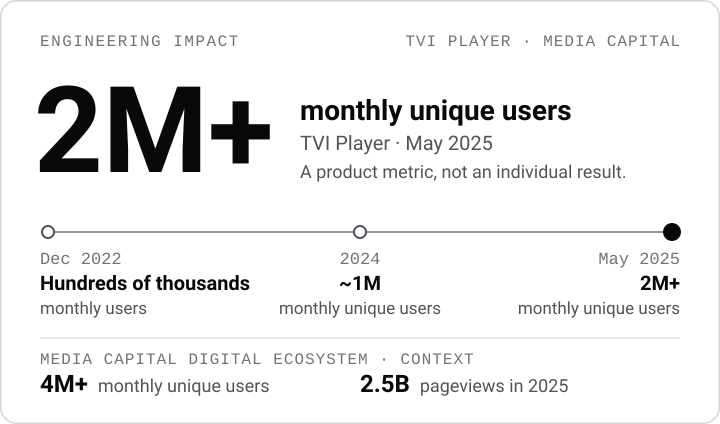
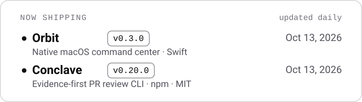

<picture>
  <source media="(prefers-color-scheme: dark)" srcset="assets/hero-dark.svg">
  
</picture>

[Portfolio](https://matheuscarvalho.me) · [LinkedIn](https://www.linkedin.com/in/matheusrcarvalho/) · [Case studies](https://matheuscarvalho.me/en/projects)

I build the Smart TV apps of **TVI Player** (LG webOS, Samsung Tizen, Android TV), Media Capital's streaming product, and the web products around it. Brazilian, based in Madrid. I like software that has to survive real devices, real traffic and real constraints.

## Engineering impact

<picture>
  <source media="(prefers-color-scheme: dark)" srcset="assets/impact-dark.svg">
  
</picture>

**2M+ monthly unique users** on TVI Player. These are product and ecosystem metrics published by Media Capital, not individual results. My part is the CTV / Smart TV engineering. Sources: [MC News](https://mcnews.iol.pt/geral/21-05-2025/o-tvi-player-mudou-experimente-ja-as-novas-funcionalidades), [Media Capital 2024 report](https://mediacapital.pt/wp-content/uploads/2025/05/deae7d5f9aed81ae1323fef2d4276ac8.pdf), [ECO](https://eco.sapo.pt/2026/03/29/tvi-acelera-sic-ainda-a-procura-de-futuro/).

## Professional work

- **TVI Player** · CTV / Smart TV engineering on React, TypeScript and Cordova. Video players, HLS / DASH, VAST / SCTE-35 ads, remote navigation and focus management, debugged on real devices.
- **CNN Portugal** · Interactive election results components with maps and data visualization.
- **SNS24** · Frontend and backend work on Portugal's public health portal, including the COVID vaccination certificate.

Details and context for each one on [matheuscarvalho.me](https://matheuscarvalho.me/en/projects).

## Independent projects

- **[Orbit](https://github.com/carvalhobfr/orbit-releases)** · A native macOS command center in Swift (macOS 14+): workspaces, a rearrangeable menu bar panel, a command palette and Mac health. Closed source; builds are published at [orbit-releases](https://github.com/carvalhobfr/orbit-releases/releases).
- **[Conclave](https://github.com/carvalhobfr/conclave-ai)** · Open source (MIT), on [npm](https://www.npmjs.com/package/conclave-ai). A PR companion that turns code changes into reviewable evidence: local and deterministic, no API key and no telemetry, read-only, with findings that point to a file and line. TypeScript, Node.js 20+.
- **[VAST Inspector](https://matheuscarvalho.me/en/tools/vast-inspector)** · A free tool for CTV ad tech: decode VAST tag URLs, review query parameters and catch common player-debugging issues. Runs locally in the browser.
- **[Pokepilot](https://github.com/carvalhobfr/pokepilot)** · Work in progress. Bots play the real Pokémon Blue ROM on an emulator, and every bit of progress is verified in cartridge RAM instead of trusted from a script. Python, PyBoy.

## Now shipping

<picture>
  <source media="(prefers-color-scheme: dark)" srcset="assets/shipping-dark.svg">
  
</picture>

Latest [Orbit](https://github.com/carvalhobfr/orbit-releases/releases/latest) and [Conclave](https://www.npmjs.com/package/conclave-ai) releases, refreshed daily.

